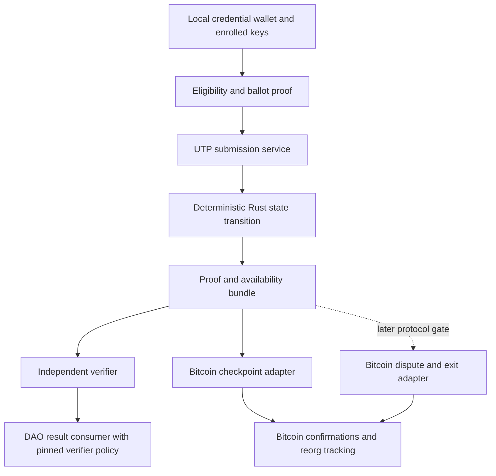

# UTP Bitcoin-verifiable and post-quantum implementation specification

Date: 2026-11-03. Status: **PROPOSED — awaiting caller or council validation**. Scope: architecture and acceptance contract, not implementation authorization. Research: [RESEARCH.md](RESEARCH.md). Exact upstream snapshots: [UPSTREAM-PINS.json](UPSTREAM-PINS.json).

## Objective

Implement a path from the existing UTP civic/Rootstock DAO application to verifiable execution and confidential eligible voting, with explicitly scoped post-quantum authorization and Bitcoin-backed enforcement. Preserve the nationwide legislative-participation objective. Do not equate an audit commitment, sidechain DAO or PQ signature demo with the completed custom Bitcoin L2.

## Current versus desired state

Current source baseline: GitHub master `777658f5d1a5c40bd4f765aa6174abc7d3ebfbd2`, independently resolved during research. Canonical local checkout is dirty at `d81e60b`; preserve it. Existing Governor/timelock, public polling, account-linked Supabase vote API, placeholder crypto interfaces and mock hybrid tests are reusable scaffolding. No integrated custom Bitcoin proof/exit pipeline was established by inspection. Earlier 175-contract/two-web-test results remain historical.

Desired behavior: eligible users retain credentials locally, authorize actions with enrolled keys, submit verifiable ballots without identity leakage, and obtain independently checkable inclusion/tally receipts. Operators cannot make invalid state valid merely by anchoring it. After the final protocol gate, users have the documented Bitcoin-enforced exit/dispute rights even when UTP operators fail. DAO actions control only explicitly enumerated powers and cannot silently lower verifier/key security.

## Proposed architecture

Initial components: existing Next.js/React and Supabase account layer; existing Rootstock Solidity governance; narrow Rust state/proof service; ML-DSA-65 benchmark profile; native STARK execution receipts; Bitcoin Core regtest followed by an explicitly selected public test network. RISC Zero is the first public-execution benchmark candidate, Stwo the challenger. Neither is automatically approved for confidential ballot witnesses. BitVM3 and BitVMX remain bridge research candidates. No custom merged-mined chain is selected.

Proposed new modules live under `research/bitcoin-l2/` until accepted; production adapters are promoted only after gates. Do not install SDKs, start services or run external deployments as part of this research document.

## Interfaces to specify before coding

- `AuthorityBinding`: subject commitment, classical key identifier, PQ algorithm/parameter ID, PQ public-key commitment, key epoch, authorized purposes, recovery-policy digest and enrollment evidence. No phone/camera PII in public records.
- `ActionEnvelope`: protocol version, network/chain, application/contract, action type, canonical payload hash, nonce, expiry, policy version and key epoch. Reject unknown versions and ambiguous encodings. Both signature checks cover the same semantic action.
- `ElectionPolicy`: immutable election/jurisdiction/scope, eligible-set root and epoch, choices, opening/closing rule, revocation policy, duplicate/revote policy and verifier ID. Initial experiment is one accepted ballot per stable eligibility secret; production revoting policy requires a separate specification.
- `BallotReceipt`: scoped nullifier, ballot commitment/ciphertext identifier, proof identifier and inclusion status. No public account identifier in the anonymous flow. Do not use email sessions as the public proof of eligible identity.
- `BatchStatement`: previous/new state roots, election/policy/verifier identifiers, batch sequence, input and availability commitments, accepted/rejected counts, applicable Bitcoin reference. Proofs must bind these values and the exact program image.
- `BitcoinCheckpoint`: network genesis identity, transaction/output, block hash/height, confirmation depth, inclusion evidence and reorg state. Validate with a full node; a second independent source detects disagreement but is not a substitute for consensus validation.

These are proposed contracts, not implemented endpoints or wire formats. Canonical byte encodings and hash/domain choices require test vectors and review before use.

## Work packages and gates

| Gate | Implementation scope after validation | Mandatory acceptance |
|---|---|---|
| G0 — baseline | Isolated branch from current master; map dirty auth work deliberately; preserve legacy CI | Re-run `npm ci`, `npm run ci:fast`, `npm run build` on that branch; record SHA and nonzero test counts. No old log substituted for this result. |
| G1 — bound PQ authority | Native ML-DSA adapter, enrolled key registry, hybrid action validation and rotation/recovery | Official vectors and independent implementation interoperate. Modified message/signature/key fails. Attacker with only the classical key cannot substitute, enroll over, rotate or recover an already-protected PQ identity. All alternate action paths tested. |
| G2 — deterministic execution | Small Rust state transition for public synthetic civic batches; RISC Zero native receipts versus Stwo candidate | Same ordered inputs yield same state; altered roots, image, policy, tally, proof or nonce fail independent verification. Fake receipts/dev mode and Groth16/PLONK wrappers rejected by PQ-profile policy. No confidential witness claim yet. |
| G3 — Bitcoin audit commitment | Regtest checkpoint construction, inclusion verification and reorg state machine | Valid commitment accepted only on selected network and chain. Invalid batch remains rejected even if anchored. Simulated reorg removes confirmation and rolls back dependent status consistently; no duplicate tally on replay. |
| G4 — private eligibility and tally | Select and review confidential tally protocol; implement local proof generation or documented distributed privacy mechanism | Public/operator/collusion privacy targets separately met; ineligible/revoked credential fails; duplicate and concurrent nullifiers fail; recovery cannot create extra eligibility. Independent verifier checks tally without raw credentials. Review resolves proof-system privacy advisories and all encryption/decryption assumptions. |
| G5 — Bitcoin enforcement | Reproduce chosen BitVM3/BitVMX protocol on regtest using UTP's exact verifier and data model | Honest withdrawal succeeds; invalid withdrawal is challenged; double withdrawal fails; censorship, missing challenger, unavailable data and operator insolvency outcomes match documented guarantees. Independent party runs the complete challenge transaction sequence. |
| G6 — integrated public testnet | Approved test-only deployments and DAO-controlled policy/upgrade lifecycle | Independent participants complete civic path plus governed proposal/vote/queue/wait/execute. Real chain timing, transaction receipts, independent read-back, loss/recovery and rollback demonstrated. Authority graph includes upgrades, treasury, delegation and emergency controls. |

G1 and G2 can be planned independently after G0; G3 depends on G2's batch statement. G4 may invalidate proof-engine selection and must precede private production voting. G5 cannot pass on a standalone CPU/emulator test. G6 cannot pass while any required G4/G5 property is missing. No schedule estimate until G1/G2 measurements establish effort and hardware requirements.

## Security and failure cases

| Attack/failure | Required observable result |
|---|---|
| Own PQ key supplied with stolen classical identity | Rejected against pre-existing binding; no takeover via enrollment/recovery. |
| Replay across election, chain, contract, epoch or action | Rejected; nonce consumption is atomic. |
| Issuer issues two credentials to one subject | Defined issuance/appeal controls prevent or detect it; cryptography alone is not claimed to prove unique humans. |
| Credential/key rotation during election | Stable eligibility identity prevents double voting; explicit revocation cutoff policy applies. |
| Operator changes/omits ballots | Inclusion receipts and reconciliation expose omission; invalid tally cannot finalize. Censorship escape path is tested before promising availability. |
| Private input in logs, proof transcript or hosted prover | Privacy gate fails; synthetic-only until corrected and reviewed. |
| Data withheld after root publication | No false “verified/settled” state; independent recovery or protocol-defined escape path exercised. |
| Administrator disables PQ checks or changes verifier | Fails policy; authorized upgrade requires disclosed governance/delay and preserves prior-state verifiability. |
| Token transfer/delegation bypasses protected voting | PQ scope claim fails until authority analysis covers that path. |
| Malformed proof / oversized input | Bounded resource use and explicit rejection; verifier process cannot crash the public API. |
| Bitcoin reorg or wrong-chain RPC | Confirmation state reverses correctly; no unrelated-network proof accepted. |
| Fee spike, challenger outage, censored challenge | Record actual safety/liveness boundary; no claim of unconditional exits. |

## Performance experiment

Measure fixed synthetic batches of 1, 100, 1,000 and 10,000 actions; these are workload sizes, not throughput promises. Record pinned software, CPU/GPU/RAM, warm/cold conditions, action sizes, signature costs, p50/p95 latency, proof bytes, peak RAM, prover time, verifier time, failure rates and Bitcoin transaction virtual size. Convert chain size to fees only with a named fee-rate scenario.

Proposed prototype UX target: submission acknowledgment p95 <= 2 seconds for 100 concurrent clients on declared hardware, with explicit pending/proven/Bitcoin-confirmed labels. This is not finality. No universal proof-time, TPS, bridge fee or confirmation-time SLA is accepted until measurements and the security profile are reviewed. Report weaker security settings as different profiles, never as a performance win for the selected profile.

## Test contract

Existing commands: `npm run ci:fast` and `npm run build`. Proposed Rust workspace command after implementation: `cargo test --manifest-path research/bitcoin-l2/Cargo.toml --locked`. Required named test groups: `authority_binding`, `cross_domain_replay`, `key_rotation`, `privacy_nullifier`, `invalid_execution`, `proof_policy`, `availability_recovery`, `bitcoin_reorg`, `dispute_exit`, `governance_upgrade`.

Those Rust paths/groups do not exist yet; creating them with real fixtures is part of implementation, not evidence of success. Add an executable regtest harness and an independent-verifier invocation in G3/G5; record exact commands in the resulting evidence ledger. Tests must include valid and invalid real proofs. Mocks only establish control flow and never satisfy cryptographic gates.

## Constraints and unresolved choices

- Full quantum-safe BTC custody remains unproven. BIP drafts are not deployed consensus. QSB research is not accepted as the custody foundation. Hash-power security and signature security are distinct.
- Confidential tally protocol, adversary/collusion threshold, quantum security parameters and proof-system privacy resolution require specialist review. Failure to find a suitable construction blocks G4 rather than downgrading the user's private-voting requirement.
- Wallet-first storage must account for browser XSS, hostile extensions, lost device and backup compromise. Passkeys, phone/TOTP and camera checks are authentication/proofing signals, not automatically PQ signatures or personhood.
- No real money, mainnet custody, provider changes, migrations or public deployment under this research scope. Existing merge/deploy approval concerned the prior release, not arbitrary new cryptographic infrastructure.
- Keep Dell-only CI. Review exact dependency licenses, release advisories and proof parameters before adoption; upstream main pins are research evidence only. Reuse existing components before introducing infrastructure.

## Completion labels and orchestration

Every batch records criterion, branch/base/head, changed files, dependency versions, threat case, tests/exit codes, proof hashes, runtime receipts if applicable, open failures and next action. A reviewer can replay the evidence from the pinned inputs. Stop after three failures without new evidence; do not loosen acceptance or convert a mock to PASS.

`PQ_AUTH_PROTOTYPE_ACCEPTED` requires G1. `BITCOIN_ANCHORED_EXECUTION_PROTOTYPE_ACCEPTED` requires G2/G3. `PRIVATE_VOTING_ACCEPTED` requires G4. `BITCOIN_ENFORCED_TESTNET_ACCEPTED` requires G5/G6. `FULL_CUSTOM_L2_TESTNET_ACCEPTED` additionally requires all full-scope gates in the [existing acceptance contract](../testnet-readiness-2026-10-31/SPEC.md), independent security review and resolution of custody/quantum scope. No narrower label implies a broader one.

Next bounded implementation batch after validation: G0 then G1's key-substitution regression and real ML-DSA interoperability harness. No deployed hybrid switch should be enabled by that first batch.
